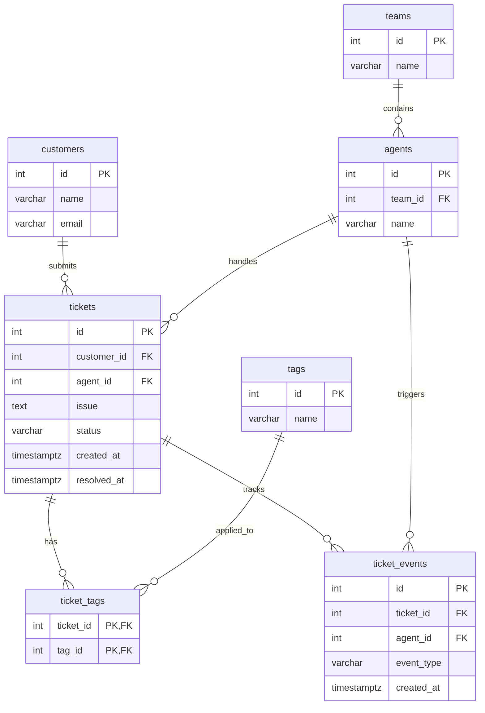

# Help Desk Backend — PostgreSQL & Async Python

A relational help desk backend built with **PostgreSQL 15 (Docker)** and **async Python (`asyncpg`, `asyncio`)**, focusing on 3NF schema design, query execution plan analysis, atomic transactions, and concurrent multi-channel ticket intake.

---

## 1. Database Normalization & ER Diagram

Starting from an unnormalized flat ticket log (with comma-separated tags, repeated customer/agent details, and team names on every row), the schema was normalized to **3NF**:

* **1NF (Atomic Values & Primary Keys):** Split multi-valued tags out of the tickets table into a `tags` table and a `ticket_tags` junction table; gave every table a primary key.
* **2NF (No Partial Dependencies):** Moved entity-specific attributes (`customers.name/email`, `agents.name`, `tags.name`) into their own tables so non-key columns depend on the entire primary key.
* **3NF (No Transitive Dependencies):** Extracted `teams` out of `agents` (`ticket → agent → team` became `agents.team_id → teams.id`) and isolated audit history into `ticket_events`.



---

## 2. `EXPLAIN ANALYZE` Index Benchmarks (50,000 Seeded Tickets)

Seed distribution: `2,510` open (~5%), `7,414` in progress (~15%), `40,076` resolved (~80%).

**Indexes added:**
```sql
CREATE INDEX idx_tickets_status_agent ON tickets (status, agent_id);
CREATE INDEX idx_tickets_customer_status ON tickets (customer_id, status);
```

| Query | Filter Selectivity | Scan Type (Before → After) | `tickets` Scan Time | Total Execution Time | Index Used? |
| :--- | :--- | :--- | :--- | :--- | :--- |
| **Query 1** (Open tickets + customer, agent, tags) | ~5% (`2,510` rows) | `Seq Scan` → `Bitmap Index Scan` (`idx_tickets_status_agent`) | `37.55 ms` → `4.37 ms` | `69.90 ms` → **`33.91 ms`** | **Yes** |
| **Query 3** (Avg resolution time per team) | ~80% (`40,076` rows) | `Seq Scan` → `Seq Scan` | `26.39 ms` → `9.43 ms` | `55.13 ms` → `36.55 ms` | **No** |

### Why the Index Helped Query 1 but Not Query 3
* **Query 1 (High Selectivity):** Only ~5% of tickets are `'open'`. Before indexing, Postgres read all 50,000 rows and discarded 47,490. With `idx_tickets_status_agent`, it jumped straight to the 2,510 matching rows via a `Bitmap Index Scan`, cutting the table scan by ~8.5x and halving total execution time.
* **Query 3 (Low Selectivity):** ~80% of tickets are `'resolved'`. Fetching 40,076 rows through an index requires thousands of random heap lookups, which is more expensive than reading the table sequentially. PostgreSQL's cost-based planner intentionally ignored the index and kept the `Seq Scan`. *(The drop from `55.13 ms` to `36.55 ms` was due to shared-buffer cache warming from the earlier runs, not the index.)*

### Atomic Resolution Transaction
Resolving a ticket in `db/queries.sql` wraps `UPDATE tickets` and `INSERT INTO ticket_events` inside a `BEGIN ... COMMIT` block. If either statement fails, Postgres rolls back the entire transaction so a ticket can never be marked `'resolved'` without a matching `'resolve'` audit entry.

---

## 3. Async Multi-Channel Intake (`async_intake.py`)

Simulates ingesting tickets from three external channels (`email`: 1.0s, `chat`: 0.8s, `phone`: 1.2s), writes them to PostgreSQL using an `asyncpg` connection pool capped by `asyncio.Semaphore(5)`, and isolates channel failures via `asyncio.gather(..., return_exceptions=True)`.

| Mode | Tickets Fetched | Elapsed Time | Notes |
| :--- | :--- | :--- | :--- |
| **Sequential** | 8 | `3.00s` | Sum of all channel waits (`1.0 + 0.8 + 1.2`) |
| **Concurrent (`asyncio.gather`)** | 8 | **`1.19s`** | Bounded by slowest single channel (~2.5x speedup) |
| **Fault-Isolated (`phone` fails)** | 6 | `1.21s` | `email` & `chat` succeed; error logged (`phone webhook returned 503`) |

### Why `asyncio` Helps Here (and When It Doesn't)
* **I/O-bound work (helps):** Network calls, webhooks, and database queries spend most of their time waiting for external responses. While one coroutine awaits I/O, the event loop switches to other coroutines, overlapping the wait times.
* **CPU-bound work (does not help):** `asyncio` runs on a single thread (and Python is bound by the GIL). Heavy computation like image processing, encryption, or matrix math blocks the event loop and runs no faster—or slightly slower—than synchronous code; CPU-bound workloads require `multiprocessing` or native extensions instead.

---

## 4. How to Run

### Prerequisites
* Docker Desktop
* Python 3.11+

### Setup & Run
1. **Start PostgreSQL (auto-runs `schema.sql` and seeds 50,000 tickets on port `5433`):**
   ```powershell
   cd db
   docker compose up -d
   cd ..
   ```

2. **Install Python dependencies:**
   ```powershell
   pip install asyncpg pytest pytest-asyncio
   ```

3. **Run the SQL queries against the container:**
   ```powershell
   Get-Content db\queries.sql | docker exec -i helpdesk_db psql -U postgres -d helpdesk
   ```

4. **Run the async intake benchmark & DB insert:**
   ```powershell
   python async_intake.py
   ```

5. **Run the test suite:**
   ```powershell
   python -m pytest tests/test_db.py -v
   ```

   
Time complexity of the diferent functions of help desk class


**Raise Ticket** | O(1) | 

Modifying the tail pointer to append to a linked list takes constant time. Dictionary assignments and set insertions are also average O(1). |


| **Resolve Ticket** | O(1) |

 Updating the head pointer to sever the front node from the linked list takes constant time. Appending to Python lists (history and stack) is O(1). |


| **Undo Action** | O(N) |

 Popping from the stack and inserting at the head of the linked list are O(1). However, removing the ticket from the resolved_history array using .remove() requires iterating through the list, making the overall method O(N) where N is the history size. |

| **ID Lookup** | O(1) | Python dictionaries use hash tables, providing instant lookups by key. |